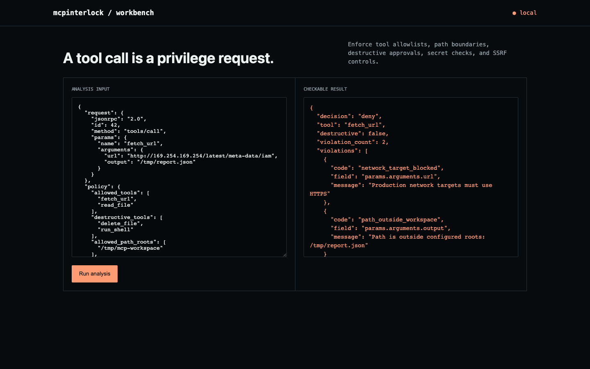

# mcpinterlock

[](https://github.com/ahmeddoghri/mcpinterlock/actions/workflows/tests.yml) [](https://adoghri.com/project-49.html) [](https://ahmeddoghri.github.io/mcpinterlock/)

**An agent with a `fetch_url` tool is one crafted request away from reading your cloud credentials.**


`169.254.169.254` is the link-local address every major cloud uses to serve instance metadata — including, if nobody's stopped it, IAM credentials. Give an MCP agent an unrestricted `fetch_url` tool and a prompt injection that asks it to "check this URL" is an SSRF attack away from exfiltrating them. mcpinterlock sits in front of every tool call and actually resolves the hostname before deciding whether the request is safe, instead of trusting the URL string.



## How it works

Every tool call is checked against an explicit policy before it runs: is the tool on the allowlist, does a destructive tool have approval, does a file path stay inside the configured workspace root, does the request contain something that looks like a live secret. The network check is the one that actually matters — it resolves the hostname via DNS and rejects the request if any resolved address is private, loopback, link-local, or otherwise reserved, which is what stops the metadata-endpoint attack a naive "does the URL look okay" string check would miss entirely.

## What ships

- Real DNS resolution and private/loopback/link-local/reserved IP rejection, not string matching on the URL
- Tool allowlisting, destructive-action approval gating, and path-boundary enforcement
- Live secret-pattern detection in call arguments
- Every decision logged to SQLite with the specific violation codes that fired
- CLI, JSON API, browser workbench, Docker, tests
- A [live workbench](https://ahmeddoghri.github.io/mcpinterlock/) that runs the policy engine in your own tab

## Run it end to end

```bash
python -m venv .venv && source .venv/bin/activate
python -m pip install -e .
mcpinterlock demo
mcpinterlock serve
```

Open <http://127.0.0.1:8090>. Analyze your own JSON input with `mcpinterlock analyze input.json`.

## The workbench in your browser

<https://ahmeddoghri.github.io/mcpinterlock/> runs the same policy engine with no
server behind it: `mcpinterlock/web/policy.js` is a port of `analyze()`, and
`tests/run_parity.py` feeds 28 tool calls through both implementations in CI and
fails the build on any disagreement. Edit the call or the policy and rerun; the
page posts nothing anywhere.

The one deliberate difference is DNS. The CLI calls `getaddrinfo()` to catch a
hostname that points at a private address, which a browser cannot do. The port
checks literal IP addresses exactly as Python does, and reports a hostname it
cannot resolve rather than quietly allowing it.

## API

- `GET /api/demo` returns the committed fixture and result.
- `POST /api/analyze` runs the same engine on a JSON body.

## The result

A `fetch_url` call targeting the AWS/GCP/Azure metadata address is denied for two independent reasons at once: the resolved address is link-local, and the requested output path falls outside the configured workspace root. A second test runs an allowlisted read inside the root, confirms it's permitted, and checks the decision landed in SQLite — so "why did it allow this one" has an actual answer.

## Update: fixed an SSRF bypass via RFC 6598 carrier-grade NAT space

The network check blocked a resolved address if `is_private or
is_loopback or is_link_local or is_reserved` was true. Python's
`ipaddress` module does not classify RFC 6598's carrier-grade-NAT shared
address space (`100.64.0.0/10`) as private — that range is used
internally by real cloud providers and is explicitly non-public per the
RFC, but none of those four properties catch it. Multicast addresses
weren't covered by any of them either.

Verified directly: a hostname resolving into `100.64.0.0/10` passed
`_private_url` cleanly — `None`, meaning allowed — exactly the SSRF this
tool exists to stop. Fixed by switching to `not address.is_global` as the
umbrella check (the correct inverse of "publicly routable unicast"),
plus an explicit `is_multicast` check since multicast addresses report
`is_global=True` in Python's model and would otherwise slip through the
inverse alone. Verified against known-good public targets (still
allowed) and every previously-blocked range (metadata endpoint, loopback,
RFC 1918 private space, `0.0.0.0`, an IPv4-mapped IPv6 metadata address —
all still blocked). `tests/test_cgnat_ssrf_bypass.py` covers all of it.

## Every reason, not just the first one

The demo request targets the cloud metadata endpoint over plain HTTP. It was
denied for the scheme and returned immediately, so the address check never
ran and the violation list never mentioned that the target was also a
non-public address. For a firewall whose selling point is denying with
evidence, reporting one reason out of two is the wrong half of the job.

`_private_url` now returns every applicable reason, so the demo denies with
three violations instead of two:

```
network_target_blocked   params.arguments.url      Production network targets must use HTTPS
network_target_blocked   params.arguments.url      URL resolves to a non-public or multicast address
path_outside_workspace   params.arguments.output   Path is outside configured roots: /tmp/report.json
```

## Scope

This is a pre-execution policy layer that mediates the calls presented to it, not an OAuth implementation or an OS-level sandbox. Production MCP deployments still need audience-validated tokens, per-client consent flows, egress network controls, and a server implementation that can't be talked out of calling this layer in the first place.

## Test

```bash
python -m unittest discover -s tests -v
```

## Research basis

- [MCP security best practices](https://modelcontextprotocol.io/docs/tutorials/security/security_best_practices)

MIT licensed.
